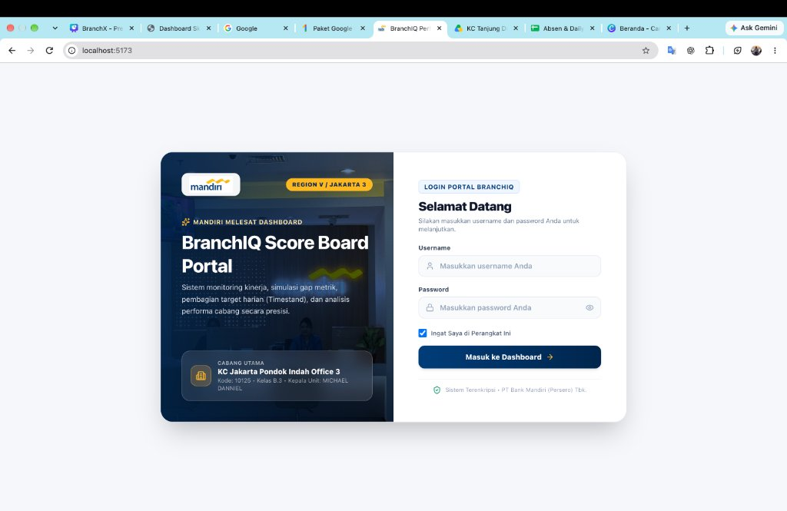
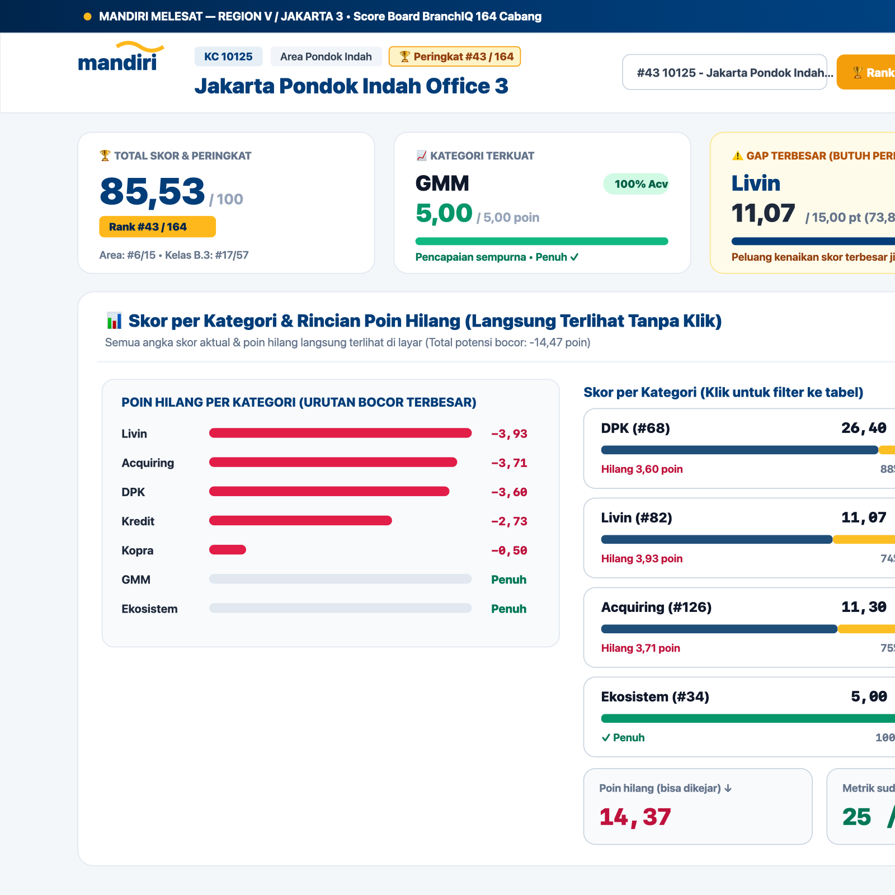
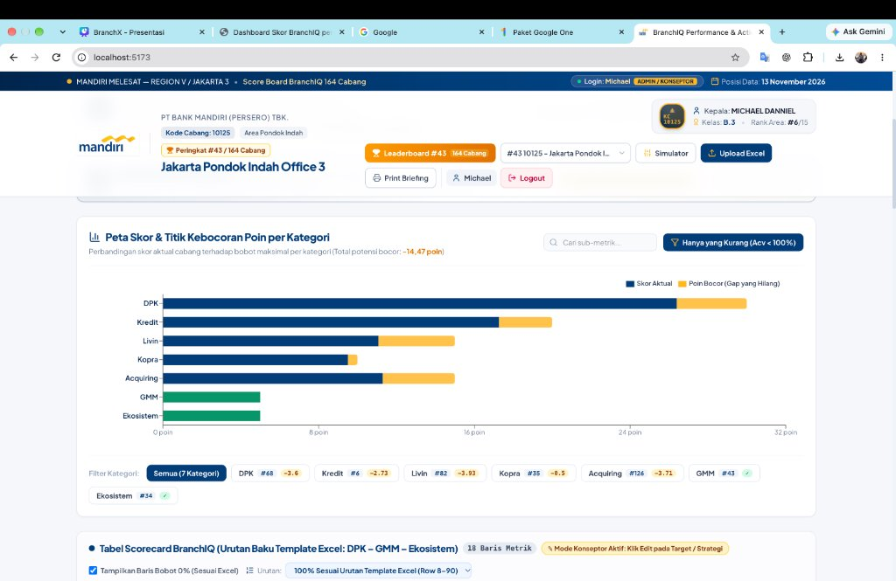
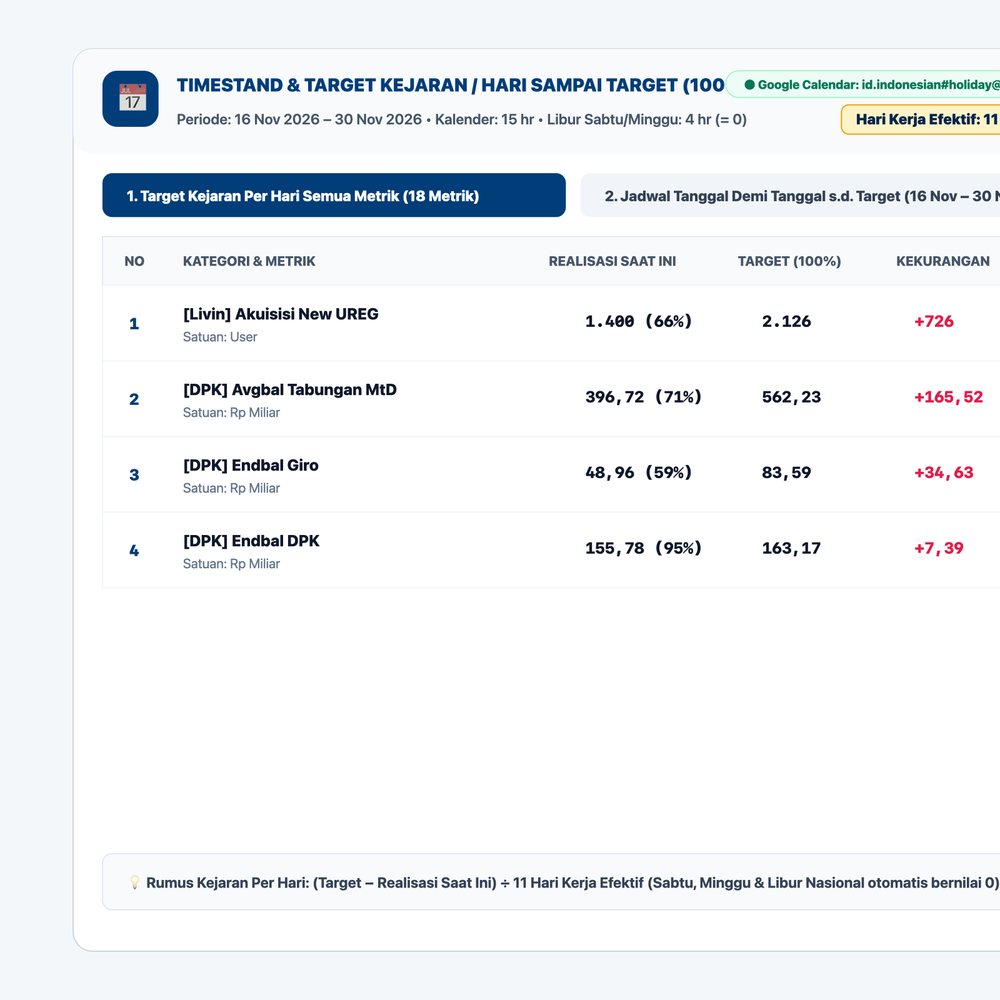
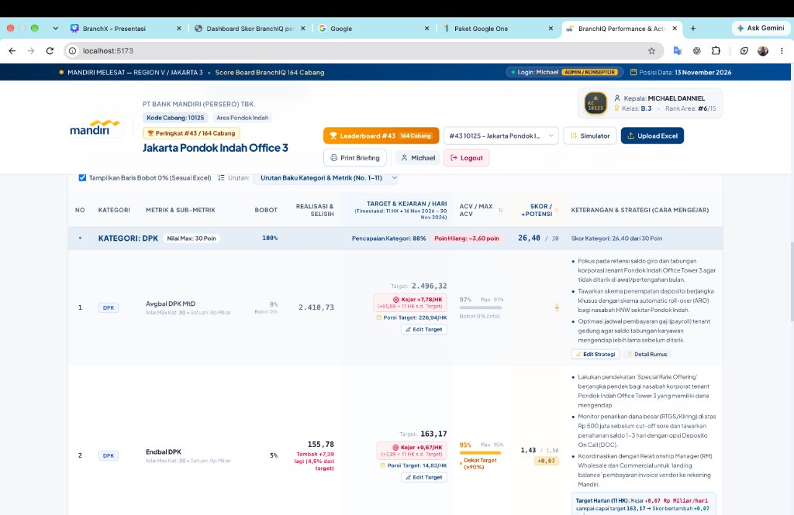
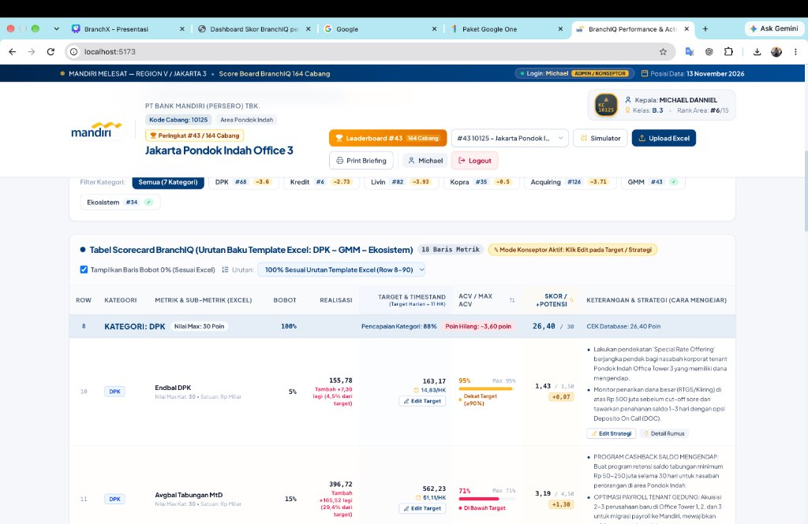
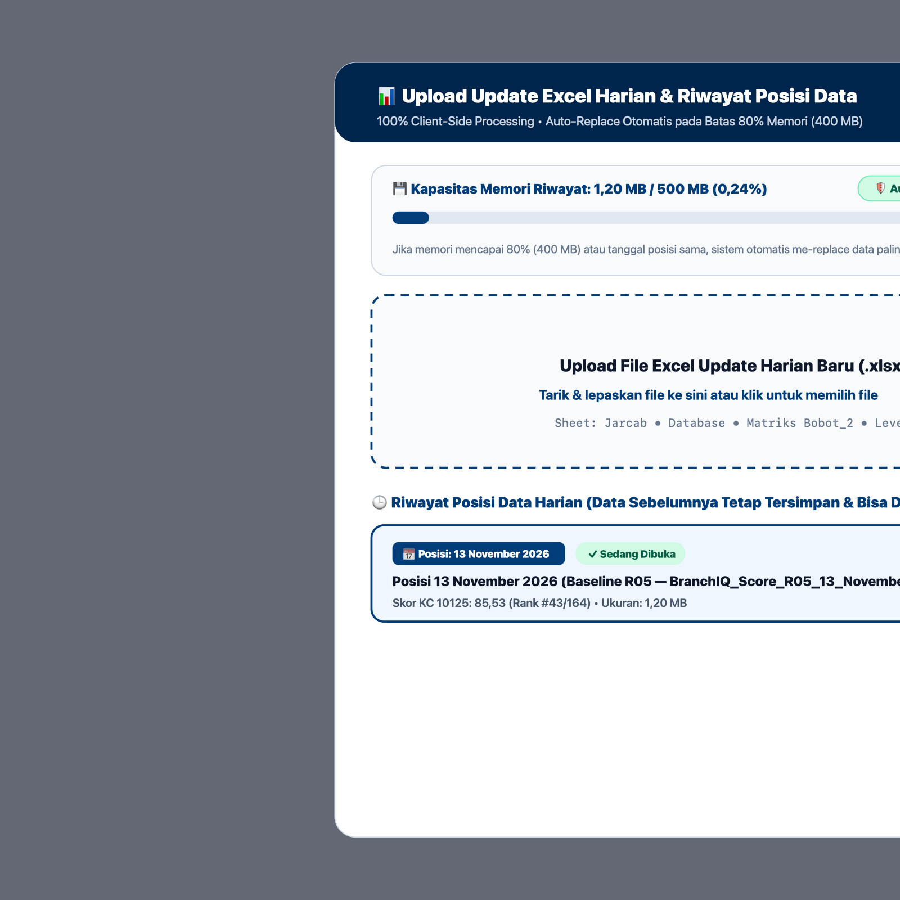
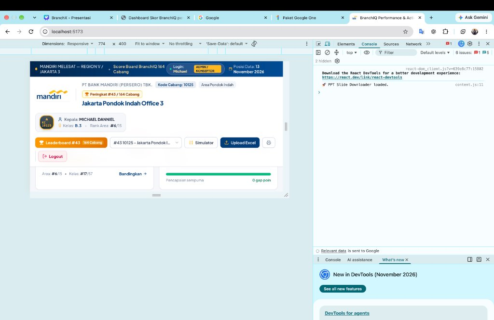
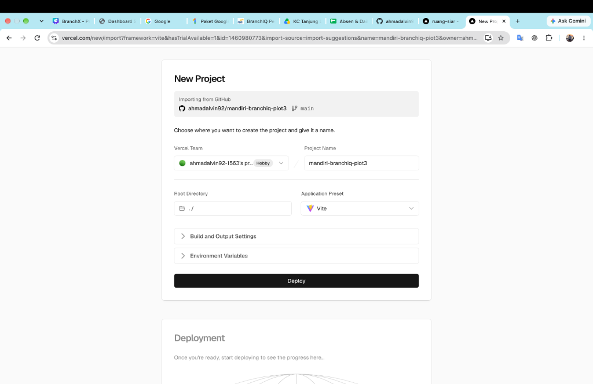
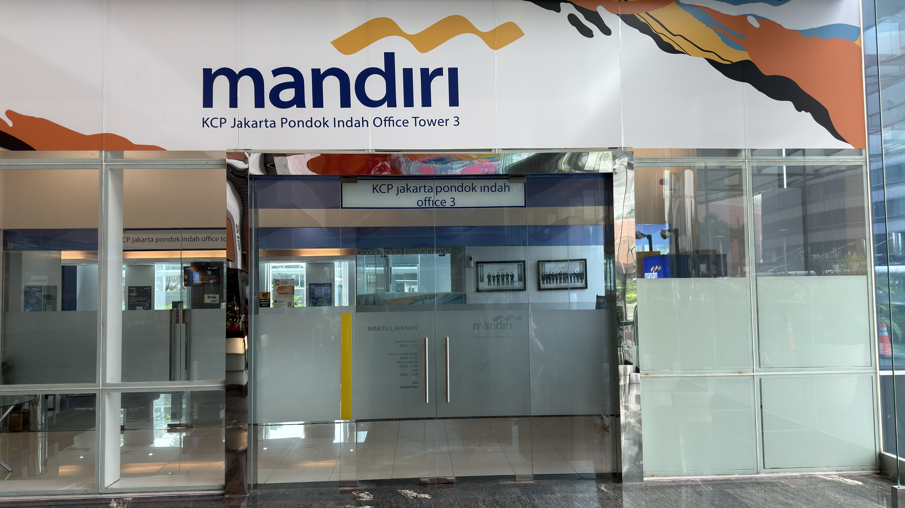

# 🏦 Mandiri BranchIQ Score Board & Actionable Performance Portal
**Region V / Jakarta 3 — KCP Jakarta Pondok Indah Office Tower 3 (Kode Cabang: 10125)**



Portal analitik kinerja cabang berbasis web (`mandiri_brach iq _score`) untuk memonitor **Scorecard BranchIQ 164 Cabang Region V / Jakarta 3**, memetakan titik kebocoran poin (*point loss*) pada **7 Kategori & 73 Sub-Metrik**, menghitung **Target Kejaran Harian (*Timestand*)** terintegrasi **Google Calendar Hari Libur Nasional Indonesia**, serta menyediakan **Simulasi Target & Strategi (*What-If Simulator*)** dengan sistem hak akses berlapis (**RBAC: Superadmin, Admin/Konseptor, dan Viewer**).

---

## 📸 Galeri Screenshot Aplikasi (`screenshoot/`)

Seluruh tangkapan layar aplikasi tersimpan di dalam folder [`./screenshoot/`](./screenshoot):

### 1. Halaman Login Portal BranchIQ
Menggunakan latar belakang eksterior **KCP Jakarta Pondok Indah Office Tower 3** dan interior layanan **Mandiri KCP PIOT** dengan form autentikasi bersih terenkripsi.


### 2. Dashboard Utama: 4 KPI Executive Summary & Skor per Kategori (Langsung Terlihat Tanpa Klik)
Menampilkan **Total Skor (`85,53 / 100`)**, **Kategori Terkuat (`GMM 100%`)**, **Gap Terbesar (`Livin -3,93 pt`)**, **Poin Hilang per Kategori**, serta **7 Kartu Skor Kategori** (`DPK 26,40 / 30`, `Kredit 17,27 / 20`, dst.) secara langsung tanpa perlu *hover* atau klik.


### 3. Header Identitas Cabang & Grafik Perbandingan Skor Kategori
Menampilkan identitas Kepala Unit (`MICHAEL DANNIEL`), Kelas Cabang (`B.3`), Peringkat Regional (`#43 / 164 Cabang`), Peringkat Area (`#6 / 15`), pemilih cabang, dan grafik perbandingan skor aktual terhadap bobot maksimal.


### 4. Timestand & Target Kejaran Harian (Integrasi Google Calendar Libur Nasional)
Menghitung otomatis **Hari Kerja Efektif (HK)** dengan mengecualikan Sabtu, Minggu, dan Hari Libur Nasional Indonesia (`id.indonesian#holiday@group.v.calendar.google.com`), serta menampilkan **Harus Dikejar / Hari** dan **Simulasi Estafet Harian s.d. 100% Target**.


### 5. Tabel Scorecard BranchIQ (Penomoran 1–N) & Target Kejaran / Hari
Menampilkan tabel terstruktur dengan penomoran berurutan mulai dari **No. 1**, kolom **Realisasi & Selisih**, kolom **Target & Kejaran / Hari (`Kejar +X,XX/HK`)**, serta tombol **Lihat Strategi** yang dapat dibuka/ditutup sesuai kebutuhan.


### 6. Detail Rincian Strategi & Taktik Eksekusi Cabang


### 7. Modal Upload Excel Harian, Riwayat Posisi Data & Auto-Replace Memori 80% (400 MB / 500 MB)
Menampilkan indikator kapasitas memori riwayat (`X,XX MB / 500 MB`) dengan proteksi **Auto-Replace Otomatis saat mencapai $\ge 80\%$ (`400 MB`)** serta daftar **Riwayat Posisi Data Harian** untuk membuka kembali data hari-hari sebelumnya.


### 8. Tampilan Responsif (Mobile / Tablet View) & Konfigurasi Deploy Vercel
| Tampilan Responsif Mobile / Tablet | Konfigurasi Deploy Vercel |
| :---: | :---: |
|  |  |

### 9. Gedung & Interior KCP Jakarta Pondok Indah Office Tower 3
| Eksterior KCP Pondok Indah Office Tower 3 | Interior Layanan Mandiri KCP PIOT |
| :---: | :---: |
|  |  |

---

## 🛠️ Bahasa Pemrograman, Framework & Teknologi yang Digunakan

| Komponen / Layer | Teknologi / Bahasa | Versi | Fungsi Utama dalam Aplikasi |
| :--- | :--- | :--- | :--- |
| **Bahasa Utama** | **JavaScript (ES2024 / JSX)** | ESNext | Logika bisnis perhitungan skor BranchIQ, kalkulasi *Timestand* hari kerja efektif, RBAC, dan manajemen *state*. |
| **UI Framework** | **React.js** | `v19.2.0` | Arsitektur komponen deklaratif (*Hooks*: `useState`, `useMemo`, `useEffect`) untuk reaktivitas instan saat simulasi angka & pindah cabang. |
| **Build Tool & Bundler** | **Vite** | `v8.3.8` | *Module bundler* berkecepatan tinggi dengan *Hot Module Replacement (HMR)* dan *API middleware* lokal. |
| **Styling & Layout** | **Tailwind CSS** | `v4.2.2` | Desain antarmuka responsif (*Mobile-First Card View* & *Desktop Table View*) dengan tema warna korporat Bank Mandiri (`#003D79` Navy & `#FFB81C` Gold). |
| **Excel Engine** | **SheetJS (`xlsx`)** | `v0.18.5` | Membaca & mem-parsing file Excel `.xlsx` (4 sheet: *Jarcab*, *Database*, *Matriks Bobot_2*, *Level Cabang*) **100% di sisi browser (*client-side*)**. |
| **Visualisasi Data** | **Recharts** | `v3.8.1` | Grafik *Stacked Horizontal Bar Chart* interaktif dengan `<LabelList>` langsung untuk memetakan skor aktual vs poin bocor. |
| **Sistem Ikon** | **Lucide React** | `v1.16.0` | Ikonografi vektor modern untuk indikator KPI, kalender, status pencapaian, dan navigasi. |
| **Kalender Hari Libur** | **Google Calendar API & iCal** | `v3` | Sinkronisasi hari libur nasional & cuti bersama Indonesia (`id.indonesian#holiday@group.v.calendar.google.com`) untuk menghitung Hari Kerja Efektif (HK). |
| **Database & Storage** | **IndexedDB + LocalStorage + JSON Sync** | Native Web API | Penyimpanan *Daily Excel History Snapshots* hingga batas aman **80% dari 500 MB (400 MB)** dengan mekanisme **Auto-Replace (FIFO)**. |
| **Deployment & Security** | **Vercel (`vercel.json`)** | Production | Konfigurasi *SPA Rewrites* dan *HTTP Security Headers* (`X-Robots-Tag: noindex`, `X-Frame-Options: DENY`, `X-Content-Type-Options: nosniff`). |

---

## 📂 Struktur Folder Proyek (`mandiri_brach iq _score`)

```text
mandiri_brach iq _score/
├── screenshoot/                   # Folder khusus tangkapan layar semua POV aplikasi
│   ├── 01-login-portal-mandiri-kcp-piot.jpg
│   ├── 02-header-dan-peta-skor-kategori.jpg
│   ├── 03-tabel-scorecard-dan-target-harian-timestand.jpg
│   ├── 04-detail-metrik-dan-strategi-cabang.jpg
│   ├── 05-tampilan-responsif-mobile.jpg
│   ├── 06-konfigurasi-deploy-vercel.png
│   ├── 07-eksterior-cabang-pondok-indah.jpg
│   ├── 08-interior-mandiri-kcp-piot.jpg
│   ├── 09-skor-per-kategori-dan-kpi-summary.png
│   ├── 10-timestand-target-kejaran-per-hari.png
│   └── 11-modal-upload-dan-auto-replace-80persen.png
├── public/                        # Aset statis, foto cabang, & sampel Excel resmi
├── src/
│   ├── components/                # Komponen UI React (LoginPage, Header, CategoryCharts, TimestandControl, MetricsTable, dll.)
│   ├── utils/                     # Kalkulator Excel, History Auto-Replace 80%, Google Calendar & RBAC
│   └── data/                      # Dataset baseline R05 KC 10125 & 164 cabang Region V
├── vercel.json                    # Konfigurasi routing SPA & security headers untuk Vercel
├── vite.config.js                 # Konfigurasi bundler Vite & middleware API
└── package.json                   # Daftar dependensi & skrip npm
```
