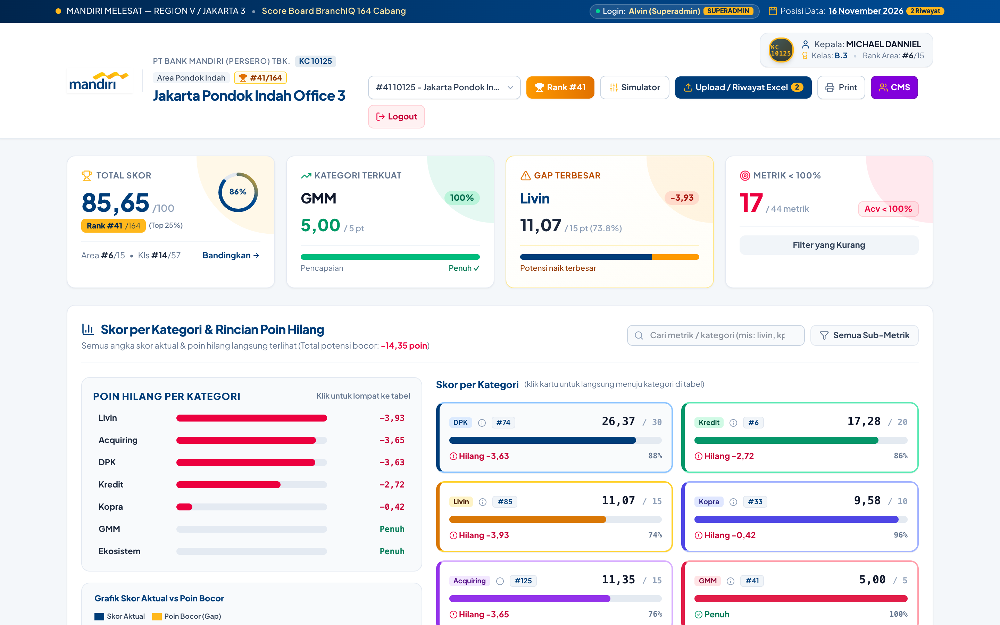
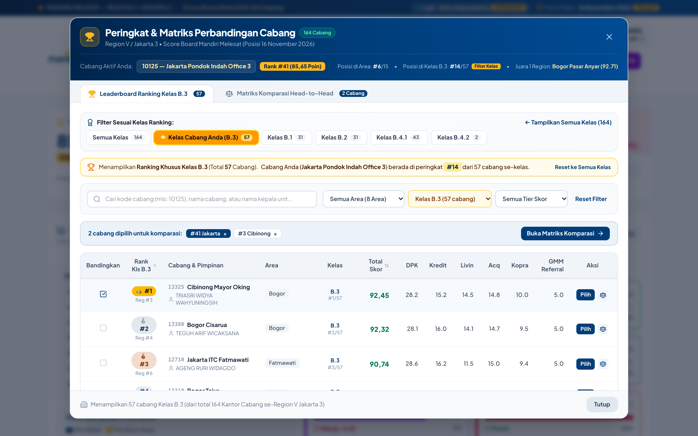
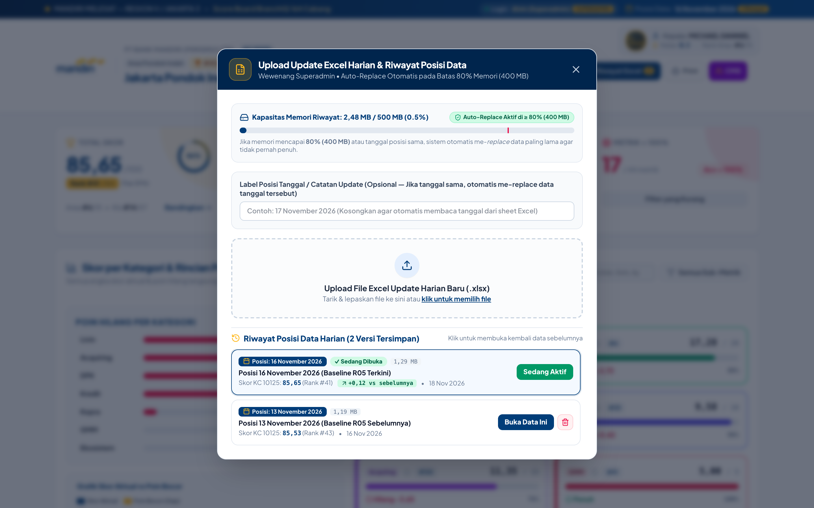
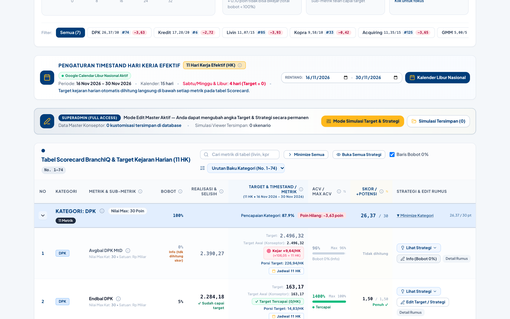
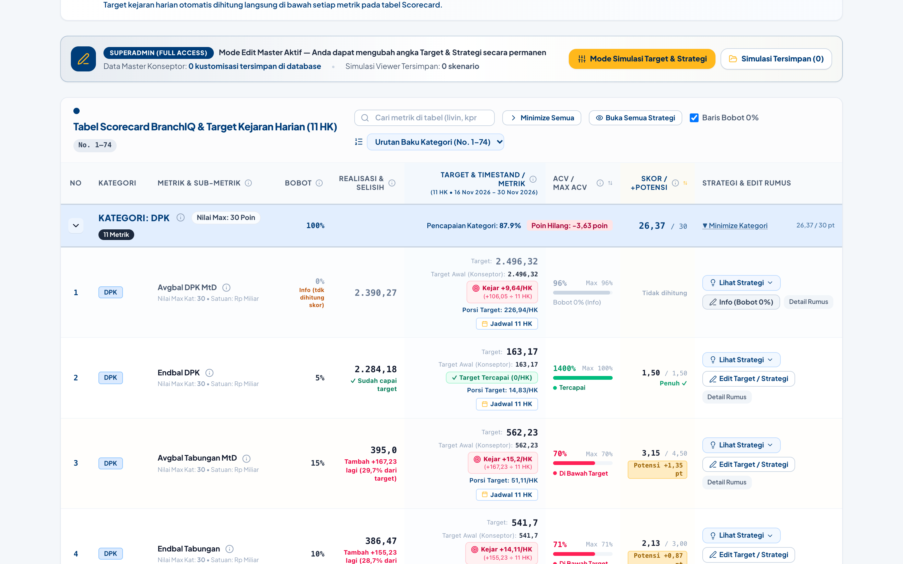
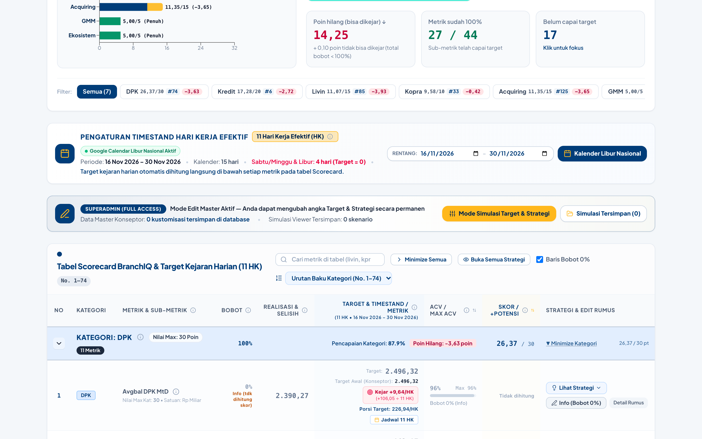
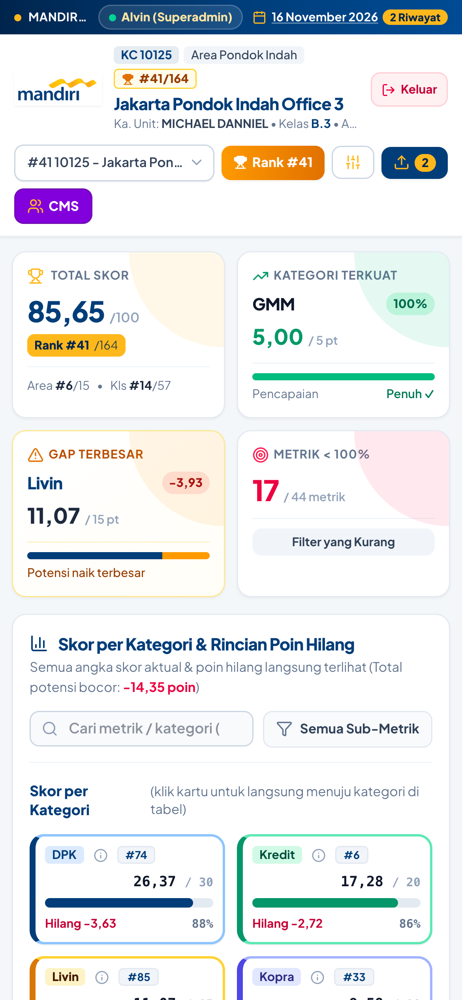

# 🏦 Mandiri BranchIQ Score Board & Actionable Performance Portal
**Region V / Jakarta 3 — KC Jakarta Pondok Indah Office 3 (Kode Cabang: 10125)**


Portal analitik kinerja cabang berbasis web (`mandiri_brach iq _score`) untuk memonitor **Scorecard BranchIQ 164 Cabang Region V / Jakarta 3**, memetakan titik kebocoran poin (*point loss*) pada **7 Kategori & 73 Sub-Metrik**, menghitung **Target Kejaran Harian (*Timestand*)** terintegrasi **Google Calendar Hari Libur Nasional Indonesia**, serta menyediakan **Simulasi Target & Strategi (*What-If Simulator*)** dengan sistem sinkronisasi **Supabase Cloud Database (PostgreSQL)** dan **Multi-Role RBAC (Superadmin, Admin, Viewer)**.

---

## 📸 Galeri Screenshot Aplikasi (`screenshoot/`)

Seluruh tangkapan layar aplikasi beresolusi tinggi (*Retina 2x, crisp & uncropped*) tersimpan di dalam folder [`./screenshoot/`](./screenshoot):

### 1. Halaman Login Portal BranchIQ
Form autentikasi bersih terenkripsi dengan latar belakang kantor KC Jakarta Pondok Indah Office 3.


### 2. Dashboard Utama: 4 KPI Executive Summary & Skor per Kategori
Menampilkan **Total Skor (`85,65 / 100`)**, **Ranking (`#41 / 164 Cabang`)**, **Gap Poin Terbesar**, dan **7 Kartu Skor Kategori** secara instan tanpa perlu *hover* atau klik.


### 3. Modal Peringkat 164 Cabang & Filter Kelas Cabang
Fitur komparasi leaderboard regional dengan kemampuan memfilter cabang sesuai kelasnya (**⭐ Kelas Cabang Anda B.3**, **Kelas B.1**, **Kelas B.2**, **Kelas B.4**, **Kelas B.4.1**, hingga **Semua Kelas**).


### 4. Modal Upload Excel Harian & Riwayat Cloud Supabase
Penyimpanan riwayat posisi harian multi-device berbasis **Supabase Cloud Database** dengan proteksi auto-replace dan manajemen versi yang bersih.


### 5. Timestand & Target Kejaran Harian (Integrasi Hari Libur Nasional)
Menghitung otomatis **Hari Kerja Efektif (HK)** dengan mengecualikan Sabtu, Minggu, dan Hari Libur Nasional Indonesia, serta menyajikan estafet target harian hingga 100%.


### 6. Tabel Detail Scorecard BranchIQ & Strategi Eksekusi
Tabel metrik terstruktur dari No. 1 sampai akhir, menyajikan realisasi, target, selisih gap, dan tombol aksi strategi taktis.


### 7. What-If Simulator & Panel Simulasi Skor
Simulasi interaktif dengan tombol persentase instan (`-10%`, `-5%`, `+5%`, `+10%`) untuk menghitung live dampak peningkatan metrik terhadap skor total cabang.


### 8. Tampilan Responsif (Mobile View)
Antarmuka adaptif yang optimal diakses melalui smartphone maupun tablet saat *branch visit*.


### 9. Tangkapan Layar Utuh Dashboard (Full-Page Overview)
Tangkapan layar menyeluruh aplikasi dari header hingga footer tanpa terpotong.


---

## 🛠️ Bahasa Pemrograman, Framework & Teknologi yang Digunakan

| Komponen / Layer | Teknologi / Bahasa | Versi | Fungsi Utama dalam Aplikasi |
| :--- | :--- | :--- | :--- |
| **Bahasa Utama** | **JavaScript (ES2024 / JSX)** | ESNext | Logika bisnis perhitungan skor BranchIQ, kalkulasi *Timestand*, dan *state management*. |
| **UI Framework** | **React.js** | `v19.3.1` | Arsitektur komponen deklaratif dengan performa tinggi dan reaktivitas instan. |
| **Cloud Database** | **Supabase (PostgreSQL)** | `@supabase/supabase-js v2.119.1` | Penyimpanan cloud terpusat untuk snapshot Excel, data pengguna, target harian, dan strategi cabang dengan sinkronisasi multi-device. |
| **Build Tool & Bundler** | **Vite** | `v8.3.8` | *Module bundler* berkecepatan tinggi dengan HMR dan optimasi build production. |
| **Styling & Layout** | **Tailwind CSS** | `v4.3.5` | Antarmuka modern bernuansa warna korporat Bank Mandiri (`#003D79` Navy & `#FFB81C` Gold). |
| **Excel Engine** | **SheetJS (`xlsx`)** | `v0.18.5` | Membaca & mem-parsing file Excel `.xlsx` 100% di sisi browser (*client-side*). |
| **Visualisasi Data** | **Recharts** | `v3.10.1` | Visualisasi grafik *Horizontal Stacked Bar Chart* untuk memetakan capaian skor vs titik kebocoran poin. |
| **Sistem Ikon** | **Lucide React** | `v1.73.0` | Ikonografi vektor modern untuk indikator KPI dan navigasi. |
| **Deployment** | **Vercel** | Production | Host production live di [mandiri-branchiq-piot3.vercel.app](https://mandiri-branchiq-piot3.vercel.app/). |

---

## 📂 Struktur Folder Proyek (`mandiri_brach iq _score`)

```text
mandiri_brach iq _score/
├── screenshoot/                   # Folder tangkapan layar lengkap & beresolusi tinggi
│   ├── 01-login-portal-mandiri-kcp-piot.png
│   ├── 02-dashboard-utama-summary.png
│   ├── 03-modal-peringkat-dan-filter-kelas.png
│   ├── 04-modal-riwayat-upload-excel.png
│   ├── 05-timestand-target-kejaran-harian.png
│   ├── 06-tabel-scorecard-dan-strategi.png
│   ├── 07-what-if-simulator.png
│   ├── 08-tampilan-responsif-mobile.png
│   └── 09-full-dashboard-overview.png
├── public/                        # Aset statis & file sampel Excel resmi
├── src/
│   ├── components/                # Komponen UI React (LoginPage, Header, CategoryCharts, MetricsTable, dll.)
│   ├── utils/                     # Supabase client, parser Excel, dbService, historyService, Google Calendar
│   └── data/                      # Dataset baseline 16 Nov 2026 KC 10125 & 164 cabang Region V
├── setup_supabase.sql             # Skrip DDL & policy PostgreSQL untuk Supabase Cloud Database
├── vercel.json                    # Konfigurasi routing SPA & security headers untuk Vercel
├── vite.config.js                 # Konfigurasi bundler Vite
└── package.json                   # Dependensi & skrip npm
```
