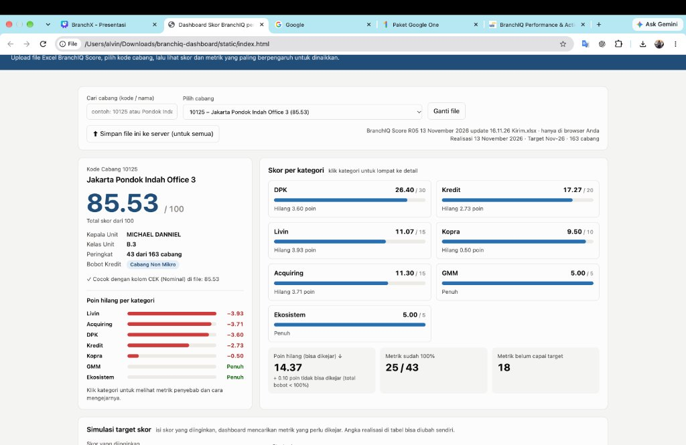
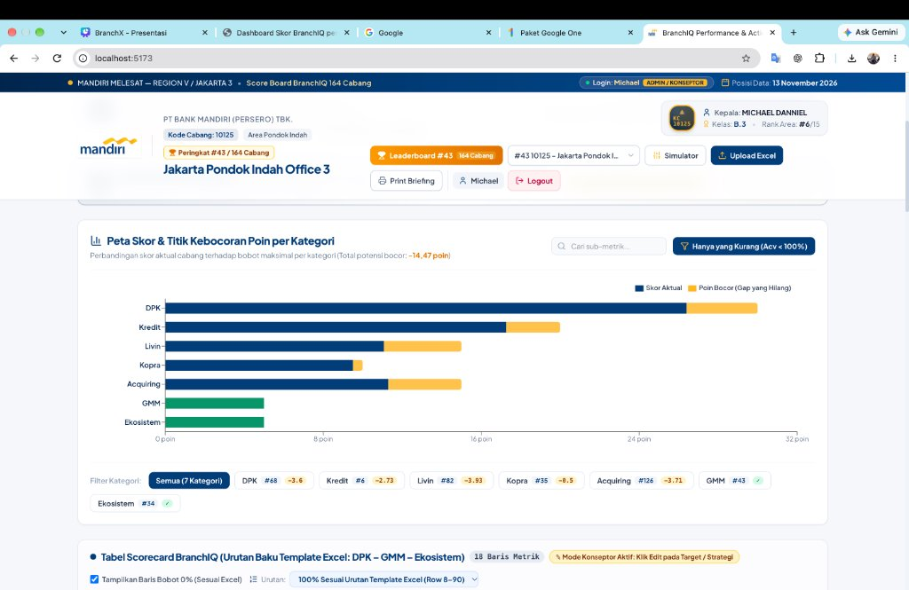
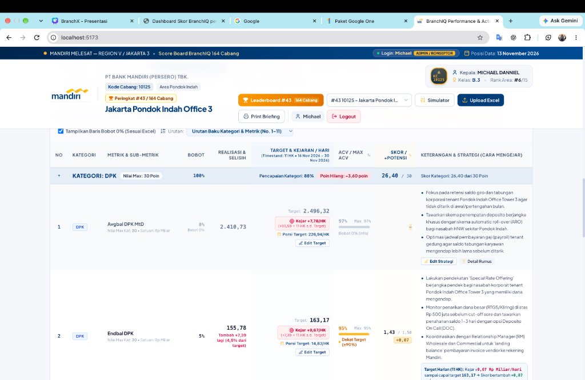
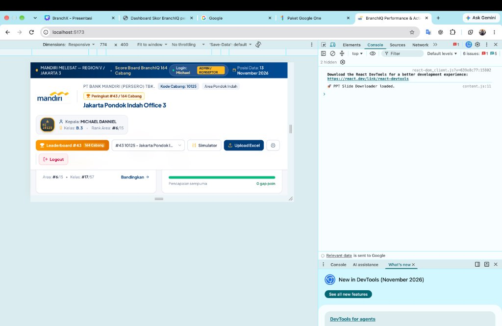

# 🏦 Mandiri BranchIQ Score Board & Actionable Performance Portal
**Region V / Jakarta 3 — KCP Jakarta Pondok Indah Office Tower 3 (Kode Cabang: 10125)**


Portal analitik kinerja cabang berbasis web untuk memonitor **Scorecard BranchIQ 164 Cabang Region V / Jakarta 3**, memetakan titik kebocoran poin (*point loss*) pada **7 Kategori & 73 Sub-Metrik**, menghitung **Target Kejaran Harian (*Timestand*)** terintegrasi **Google Calendar Hari Libur Nasional Indonesia**, serta menyediakan **Simulasi Target & Strategi (*What-If Simulator*)** dengan sistem hak akses berlapis (**RBAC: Superadmin, Admin/Konseptor, dan Viewer**).

---

## 📸 Tangkapan Layar Aplikasi (All POVs)

### 1. POV Halaman Login & Identitas Cabang
Menggunakan latar belakang eksterior **KCP Jakarta Pondok Indah Office Tower 3** (`cabang_pondok_indah.jpg`) dan interior layanan **Mandiri KCP PIOT** (`mandiri_kcp_piot.jpg`) dengan form autentikasi bersih terenkripsi.


### 2. POV Ringkasan Skor per Kategori & Poin Hilang (Langsung Terlihat Tanpa Klik)
Menampilkan **Total Skor (`85,53 / 100`)**, **Poin Hilang per Kategori** (diurutkan dari kebocoran poin terbesar: *Livin, Acquiring, DPK, Kredit, Kopra, GMM, Ekosistem*), serta **7 Kartu Skor Kategori** yang langsung menampilkan angka aktual vs maksimal (`26,40 / 30`, `17,27 / 20`, dst.) tanpa perlu *hover* atau klik.


### 3. POV Header & Grafik Perbandingan Skor Kategori
Menampilkan identitas Kepala Unit, Kelas Cabang (`B.3`), Peringkat Regional (`#43 / 164 Cabang`), Peringkat Area (`#6 / 15`), pemilih cabang, dan grafik perbandingan skor aktual terhadap bobot maksimal.


### 4. POV Tabel Scorecard BranchIQ (No. 1–N), Target Kejaran Harian (Timestand) & Strategi
Menampilkan tabel terstruktur dengan penomoran berurutan mulai dari **No. 1**, kolom **Realisasi & Selisih**, kolom **Target & Kejaran / Hari (Berdasarkan Hari Kerja Efektif Timestand)**, serta rincian **Strategi (Cara Mengejar)** yang dapat dibuka/ditutup dengan klik.


### 5. POV Tampilan Responsif (Mobile / Tablet View)
Tampilan adaptif untuk perangkat *mobile* dan *tablet* dengan *non-sticky header* (tidak menutupi layar saat *scroll* ke bawah), kartu KPI 2 kolom, dan *Mobile Card View* untuk tabel metrik.


### 6. POV Gedung & Interior KCP Jakarta Pondok Indah Office Tower 3
| Eksterior KCP Pondok Indah Office Tower 3 | Interior Layanan Mandiri KCP PIOT |
| :---: | :---: |
|  |  |

---

## 🛠️ Bahasa Pemrograman, Framework & Teknologi yang Digunakan

Proyek ini dibangun menggunakan arsitektur **Modern Client-Side Single Page Application (SPA)** dengan detail teknologi sebagai berikut:

| Komponen / Layer | Teknologi / Bahasa | Versi | Fungsi Utama dalam Aplikasi |
| :--- | :--- | :--- | :--- |
| **Bahasa Utama** | **JavaScript (ES2024 / JSX)** | ESNext | Logika bisnis perhitungan skor BranchIQ, kalkulasi *Timestand* hari kerja efektif, RBAC, dan manajemen *state*. |
| **UI Framework** | **React.js** | `v19.2.0` | Arsitektur komponen deklaratif (*Hooks*: `useState`, `useMemo`, `useEffect`) untuk reaktivitas instan saat simulasi angka & pindah cabang. |
| **Build Tool & Bundler** | **Vite** | `v8.3.8` | *Module bundler* berkecepatan tinggi dengan *Hot Module Replacement (HMR)* dan *API middleware* lokal. |
| **Styling & Layout** | **Tailwind CSS** | `v4.2.2` | Desain antarmuka responsif (*Mobile-First Card View* & *Desktop Table View*) dengan tema warna korporat Bank Mandiri (`#003D79` Navy & `#FFB81C` Gold). |
| **Excel Engine** | **SheetJS (`xlsx`)** | `v0.18.5` | Membaca & mem-parsing file Excel `.xlsx` (4 sheet: *Jarcab*, *Database*, *Matriks Bobot_2*, *Level Cabang*) **100% di sisi browser (*client-side*)**. |
| **Visualisasi Data** | **Recharts** | `v3.8.1` | Grafik *Stacked Horizontal Bar Chart* interaktif dengan `<LabelList>` langsung untuk memetakan skor aktual vs poin bocor. |
| **Sistem Ikon** | **Lucide React** | `v1.16.0` | Ikonografi vektor modern untuk indikator KPI, kalender, status pencapaian, dan navigasi. |
| **Kalender Hari Libur** | **Google Calendar API & iCal** | `v3` | Sinkronisasi hari libur nasional & cuti bersama Indonesia (`id.indonesian#holiday@group.v.calendar.google.com`) untuk menghitung Hari Kerja Efektif (HK). |
| **Database & Storage** | **IndexedDB + LocalStorage + JSON Sync** | Native Web API | Penyimpanan *Daily Excel History Snapshots* hingga batas aman **80% dari 500 MB (400 MB)** dengan mekanisme **Auto-Replace (FIFO)**. |
| **Deployment & Security** | **Vercel (`vercel.json`)** | Production | Konfigurasi *SPA Rewrites* dan *HTTP Security Headers* (`X-Robots-Tag: noindex`, `X-Frame-Options: DENY`, `X-Content-Type-Options: nosniff`). |

---

## ✨ Fitur Utama Sistem

### 1. Kalkulasi Presisi 100% Sesuai Rumus Excel (`Level Cabang` & `Database`)
* **Deteksi Otomatis Bobot Kredit Cabang Non-Mikro vs Mikro**: Memilih secara otomatis matriks bobot kolom `N` (Mikro/Reguler) atau kolom `O` (Non-Mikro) pada sheet `Matriks Bobot_2` yang cocok 100% dengan kolom `CEK (Nominal)` di sheet `Database`.
* **Rumus Pencapaian (`Acv`) & `Max Acv` (Maksimal 100%)**:
  * **Metrik Normal (Pertumbuhan/Volume)**:
    $$\text{Acv} = \text{ROUND}\left(\frac{\text{Realisasi}}{\text{Target}}, 2\right), \quad \text{Max Acv} = \min(100\%, \max(0\%, \text{Acv}))$$
  * **Metrik Kualitas Kredit (`% Kol 2` & `% NPL` — semakin kecil semakin baik)**:
    $$\text{Acv} = \max\left(0, \text{ROUND}\left(1 - \frac{\text{Realisasi} - \text{Target}}{\text{Target}}, 2\right)\right)$$
  * **Skor Kinerja & Potensi Tambahan Skor (`+Potensi`)**:
    $$\text{Skor} = \text{Max Acv} \times \text{Bobot Metrik} \times \text{Nilai Maksimal Kategori}$$
    $$\text{Potensi Skor Hilang} = (1 - \text{Max Acv}) \times \text{Bobot Metrik} \times \text{Nilai Maksimal Kategori}$$

### 2. Timestand & Target Kejaran Harian Berbasis Google Calendar
* Terhubung dengan kalender resmi libur nasional Indonesia (`id.indonesian#holiday@group.v.calendar.google.com`).
* Secara otomatis mengecualikan **Hari Sabtu, Hari Minggu, dan Tanggal Merah / Cuti Bersama** ($\text{Target Libur} = 0$).
* Menghitung dua indikator harian penting untuk setiap sub-metrik:
  1. **Target Kejaran per Hari Kerja s.d. Target 100%**:
     $$\text{Kejar per HK} = \frac{\text{Target} - \text{Realisasi Saat Ini}}{\text{Jumlah Hari Kerja Efektif (HK)}}$$
  2. **Simulasi Estafet Harian Tanggal Demi Tanggal**: Menampilkan proyeksi akumulasi angka yang harus dicapai dari `HK #1` hingga `HK Terakhir` sampai menyentuh **100% Target**.

### 3. Riwayat Update Excel Harian & Auto-Replace Memori 80% (400 MB / 500 MB)
* Setiap kali file Excel harian baru di-upload, data hari sebelumnya **tetap tersimpan** di dalam **Riwayat Posisi Data Harian** (dapat dibuka kembali kapan saja dengan 1 klik beserta indikator kenaikan/penurunan skor $\Delta$ dibanding posisi sebelumnya).
* **2 Lapis Auto-Replace Otomatis**:
  1. **Same-Date Replace**: Upload ulang pada tanggal posisi yang sama otomatis menimpa data tanggal tersebut agar tidak duplikat.
  2. **80% Memory Threshold Auto-Replace (FIFO)**: Saat kapasitas penyimpanan riwayat mencapai **$\ge 80\%$ dari 500 MB (`400 MB`)**, sistem otomatis menghapus riwayat yang paling tua terlebih dahulu sehingga memori tidak pernah penuh.

### 4. Sistem Role-Based Access Control (RBAC) — 3 Level Akses
* **Superadmin** (`alvin.superadmin`, `michael.superadmin`, `amalia.superadmin`, `superadmin`):
  * Akses penuh ke seluruh fitur Konseptor + halaman **CMS Manajemen User** (tambah akun baru, ubah *role*, reset *password*, hapus user).
* **Admin / Konseptor** (`michael`, `alvin.admin`, `amal.admin`):
  * Dapat mengubah dan menyimpan permanen **Target Master**, **Strategi / Cara Mengejar** (khusus cabang atau berlaku untuk semua cabang), serta mengatur rentang tanggal **Timestand & Hari Libur**.
* **Viewer / Officer Cabang** (`alvin`, `amalia`, `rian`, `dina`, `disa`, `fia`, `wardah`, `embun`, `febri`, `arga`, `arsya`, `akbar`, `dimas`, `rafli`):
  * Mode *Read-Only* terhadap Data Master agar data utama tetap aman, namun dilengkapi **Mode Simulasi Target & Strategi** (*Save Simulation*) untuk membuat skenario usulan yang siap dipresentasikan kepada Kepala Cabang / Konseptor.

---

## 📂 Struktur Folder Proyek

```text
mandiri_brach iq _score/
├── public/                        # Aset statis, foto cabang, & sampel Excel resmi
│   ├── cabang_pondok_indah.jpg    # Foto eksterior KCP Pondok Indah Office Tower 3
│   ├── mandiri_kcp_piot.jpg       # Foto interior layanan Mandiri KCP PIOT
│   └── mandiri_logo.png           # Logo resmi Bank Mandiri
├── docs/
│   └── screenshots/               # Dokumentasi screenshot dari semua POV aplikasi
├── src/
│   ├── components/
│   │   ├── LoginPage.jsx          # Halaman autentikasi bersih dengan background cabang
│   │   ├── Header.jsx             # Navigasi responsif, pemilih 164 cabang & riwayat data
│   │   ├── ExecutiveSummary.jsx   # 4 kartu KPI utama & peringkat cabang
│   │   ├── CategoryCharts.jsx     # Kartu skor 7 kategori, bar poin hilang & grafik Recharts
│   │   ├── TimestandControl.jsx   # Kalender kerja efektif Google Calendar & tabel kejaran harian
│   │   ├── SimulationManagerBar.jsx # Kontrol RBAC & penyimpanan skenario simulasi Viewer
│   │   ├── MetricsTable.jsx       # Tabel Scorecard (No. 1-N), inline edit & strategi (klik-untuk-lihat)
│   │   ├── FileUploadModal.jsx    # Upload Excel harian, riwayat versi & bar memori 80% Auto-Replace
│   │   ├── BranchComparisonModal.jsx # Leaderboard 164 cabang Region V & komparasi head-to-head
│   │   ├── WhatIfSimulator.jsx    # Simulator interaktif perubahan skor real-time
│   │   ├── UserManagementCMS.jsx  # Halaman CMS manajemen user khusus Superadmin
│   │   └── PrintReport.jsx        # Format cetak 1 halaman untuk Morning Briefing
│   ├── utils/
│   │   ├── excelParser.js         # Mesin kalkulasi rumus Excel & parser SheetJS 4 sheet
│   │   ├── excelHistoryService.js # Manajemen IndexedDB & Auto-Replace memori 80% (400 MB)
│   │   ├── googleCalendar.js      # Integrasi Google Calendar libur nasional & kalkulator HK
│   │   ├── dbService.js           # Manajemen state pengguna, RBAC, dan sinkronisasi database
│   │   └── knowledgeBase.js       # Kamus definisi metrik perbankan & strategi taktis
│   ├── data/                      # Dataset baseline R05 KC 10125 & 164 cabang Region V
│   ├── App.jsx                    # Komponen induk pengatur alur data & halaman
│   └── main.jsx                   # Entry point aplikasi React
├── vercel.json                    # Konfigurasi routing SPA & security headers untuk Vercel
├── vite.config.js                 # Konfigurasi bundler Vite & middleware API
└── package.json                   # Daftar dependensi & skrip npm
```

---

## 🚀 Cara Menjalankan di Lokal & Deploy ke Vercel (via GitHub)

### A. Menjalankan di Komputer Lokal
1. Masuk ke direktori proyek dan instal dependensi:
   ```bash
   npm install
   ```
2. Jalankan server pengembangan (*development server*):
   ```bash
   npm run dev
   ```
3. Buka `http://localhost:5173` di browser.

### B. Cara Push ke GitHub (Private Repo) & Deploy ke Vercel
1. Buat repository baru di GitHub dengan visibilitas **Private**.
2. Jalankan perintah Git berikut di folder proyek:
   ```bash
   git init
   git add .
   git commit -m "Initial commit: Mandiri BranchIQ Score Board Portal"
   git branch -M main
   git remote add origin https://github.com/<username-anda>/<nama-repo-anda>.git
   git push -u origin main
   ```
3. Buka [Vercel Dashboard](https://vercel.com/new), pilih **Import Git Repository**, lalu pilih repository GitHub tersebut:
   * **Framework Preset**: `Vite`
   * **Build Command**: `npm run build`
   * **Output Directory**: `dist`
4. Klik **Deploy** — aplikasi langsung aktif dengan proteksi `vercel.json` dan manajemen memori otomatis 80%.
